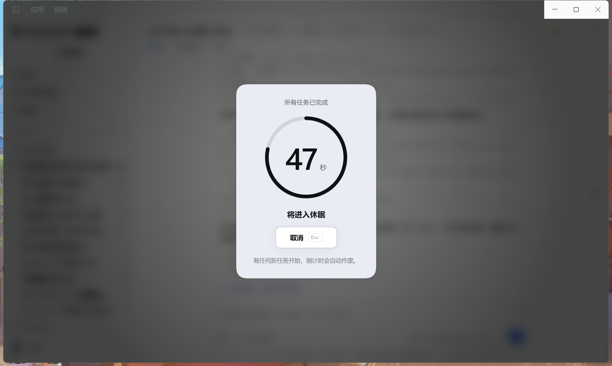
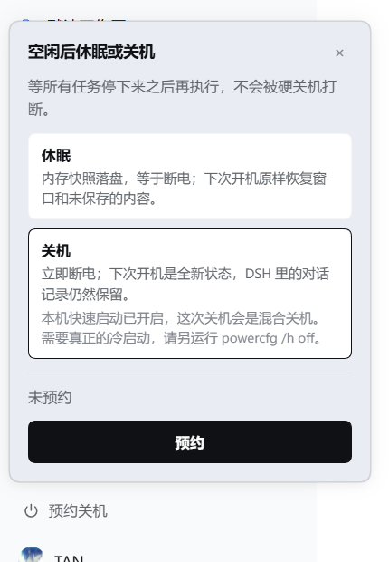

# dsh-idle-power

**English** · [简体中文](./README.zh-CN.md)

Hibernate or shut down Windows once **every** DeepSeek Harness task has finished — with a visible 60-second countdown you can cancel.

Long agent runs usually end when you have walked away. This plugin lets you say *"shut the machine down when everything is actually done"*, then keeps its promise safe: it waits for all agents, subagents and background jobs, shows a full-window countdown, and **voids itself the moment new work appears**.



| Choose what happens | While it waits |
|---|---|
|  | The sidebar entry names the live state: `Schedule shutdown`, `Waiting · 3 tasks running`, `42s to shutdown`. |

---

## Why it is safe

Turning off a machine in the middle of an agent run is the interesting problem here, so the plugin is built around not doing that.

It treats the whole Harness as busy if **any** of these is true:

| Checked | Why |
|---|---|
| `agent.status === 'running'` | an agent is taking a turn |
| `agent.inbox.nextTurn` / `.nextStep` non-empty | work has been queued but not started — the hand-off gap |
| a job is `running` or `stopping` | a shell/background job is alive, including ones owned by a session |
| subagents and workflow children | they are ordinary live agents, so one status check covers them |

Then:

1. **Quiet period — 20 s.** All of the above must stay empty continuously. A single tick with work resets the clock.
2. **Countdown — 60 s.** A full-window dialog with the remaining seconds, who is about to happen, and one `Cancel` button (`Esc` works too).
3. **Any new task voids the countdown** and drops back to waiting. You never have to race it.
4. Only when the countdown genuinely reaches zero does it run the power command.

**The countdown is the only undo you get.** `shutdown /s /t 0` runs immediately and `shutdown /h` has no `shutdown /a` counterpart, so the plugin does not rely on a Windows-provided reversal window — it provides its own.

Arming is always an explicit, human action. There is no model-facing tool, so the assistant can never decide to power off your machine.

## Modes

| Mode | Command | What you get |
|---|---|---|
| `shutdown` **(default)** | `shutdown /s /t 0 /f` | Powers off. DSH conversations are still on disk. |
| `hibernate` | `shutdown /h /f` | Writes the memory image to disk. Next boot restores every open window and unsaved edit. |

Switch modes from the panel; the sidebar entry renames itself to match (`Schedule shutdown` / `Schedule hibernate`).

> **Fast Startup note.** If Windows Fast Startup is enabled, `shutdown /s` is a *hybrid* shutdown: the kernel state is saved and the next boot resumes it. The panel says so when you pick shutdown. A true cold boot needs `powercfg /h off` (admin, permanent) — this plugin deliberately does not touch your system settings.

## Install

The plugin is a regular DSH bundle: an npm package that ships a `cordis.patch.yml` and a `dsh.client` entry.

**Option A — Plugins page (recommended).** Open the Plugins page in Harness and install the bundle `dsh-idle-power` (or the spec `github:tzzs/dsh-idle-power`). It writes the dependency and adds the bundle to your profile for you.

**Option B — edit the profile by hand.** In your profile's `package.json`, list the package and add it to the bundle list:

```jsonc
{
  "dependencies": { "dsh-idle-power": "github:tzzs/dsh-idle-power" },
  "dsh": { "profile": { "bundles": ["dsh-idle-power"] } }
}
```

Then install dependencies in the profile directory and restart Harness.

Either way, **a restart or a plugin reload is required** — the Host half registers its routes when it loads.

## Use

The entry lives at the bottom of the sidebar, next to Settings:

```
⏻ Schedule shutdown          idle
⏻ Waiting · 3 tasks running  armed, work still running
⏻ 42s to shutdown            counting down
```

Click it, pick a mode, press the action button. While a reservation is live the same button becomes **Cancel**.

Collapsed to the 56 px rail the entry degrades to an icon. On Windows the entire sidebar foot is hidden while collapsed (host behaviour) — expand the sidebar (`Ctrl+B`) to reach it.

## Configuration

Set these on the plugin row in your profile's `cordis.patch.yml`:

| Option | Default | Meaning |
|---|---|---|
| `countdownSeconds` | `60` | Countdown length, clamped to 5–3600 |
| `quietSeconds` | `20` | Required quiet period, clamped to 3–3600 |
| `defaultMode` | `'shutdown'` | `'hibernate'` or `'shutdown'` |
| `shutdownCommand` | `'shutdown'` | Power command; resolved via PATH when the plugin loads |

A mode you pick in the UI is remembered by the Host (it survives a page reload) and resets to `defaultMode` when the Host restarts.

## HTTP routes

The browser half talks to the Host over four authenticated routes. Every one runs a trust check first (Host/Origin, `sec-fetch-site`, then the auth cookie) and answers `403` / `401` without it.

| Method | Path | Purpose |
|---|---|---|
| `GET` | `/idle-power/state` | mode, phase, remaining seconds, live task counts |
| `POST` | `/idle-power/arm` | reserve; body `{ "mode": "hibernate" \| "shutdown" }` |
| `POST` | `/idle-power/cancel` | cancel a reservation or a running countdown |
| `POST` | `/idle-power/mode` | change the mode without reserving |

Execution happens in the **Host**, not the browser. Closing the tab does not stop a countdown; that is deliberate — a browser-side timer would never fire if the browser crashed. The trade-off is that an armed reservation keeps running while Harness is open.

## Requirements

- **Windows.** `shutdown.exe` is the only backend; on other platforms the plugin reports "unsupported" instead of pretending.
- A DSH profile that mounts `agents` and `webServer`. `jobs` is optional — without it the plugin still runs, it just cannot see background jobs.

## Tests

```powershell
npm test
```

Two dependency-free harnesses drive the real code with stand-ins, so the suite can run on any machine without powering anything off:

- `test/host.test.mjs` — the state machine against fake agents, fake jobs and a subprocess that records `argv` instead of executing. Covers the busy predicate, quiet behaviour, countdown voiding, both command lines, cancellation, failure reporting, and the mode route.
- `test/client.test.cjs` — renders the real `client.js` components with a minimal React stand-in and asserts on the produced tree: both entry layouts, panel states, the progress ring's geometry and its edge cases, dismissal, and `prefers-reduced-motion` coverage.

Neither suite replaces looking at the page, and neither proves that `shutdown` really powers the machine off — that needs a human clicking the button.

## License

MIT
