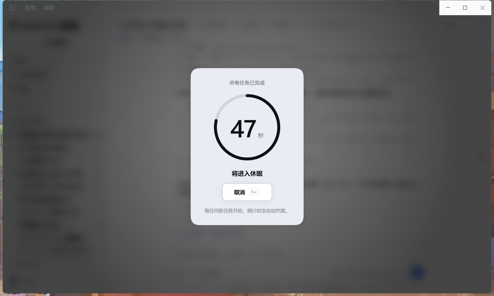
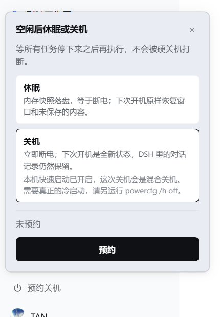

# dsh-idle-power

[English](./README.md) · **简体中文**

等 **DeepSeek Harness 里所有任务** 都跑完之后，自动休眠或关闭 Windows —— 先给你一个 60 秒的全屏倒计时，随时可以取消。

长任务通常在你离开电脑之后才结束。这个插件让你提前说一句「全部跑完了就关机」，然后它用一套防误关的机制来兑现：



| 选模式 | 等待中的入口 |
|---|---|
|  | 入口会写出当前真实状态：`预约关机` / `等待中 · 3 个任务在跑` / `42 秒后关机` |

---

## 为什么它不会把你正在跑的东西关掉

在 agent 任务进行中关机，是这个插件唯一重要的难题。所以它的判断覆盖整个 Harness：

只要满足**任意一条**，就认为还有活没干完：

| 检查项 | 原因 |
|---|---|
| `agent.status === 'running'` | 有 agent 正在执行回合 |
| `agent.inbox.nextTurn` / `.nextStep` 非空 | 已经排进队列但还没开始 —— 任务交接的空档 |
| 有 job 处于 `running` 或 `stopping` | shell / 后台任务还活着，包括挂在某个会话下面的 |

子智能体和 workflow 子节点本身就是普通 agent，所以一次状态检查就能覆盖它们。

然后：

1. **安静期 20 秒** —— 上面这些必须持续为空。任何一次检查发现活，计时归零重来。
2. **倒计时 60 秒** —— 全窗口对话框，显示剩余秒数、即将发生什么，以及唯一的「取消」按钮（`Esc` 也行）。
3. **一有新任务，倒计时立刻作废** —— 退回等待状态，你不需要和它抢时间。
4. 只有倒计时真正归零，才执行电源命令。

**倒计时是你唯一的撤销窗口。** `shutdown /s /t 0` 立即执行，`shutdown /h` 更是完全没有 `shutdown /a` 可以撤销。所以插件不依赖 Windows 提供的反悔期，而是自己提供。

预约永远是**人**的显式动作：插件不注册任何模型可见的工具，助手无法替你决定关机。

## 两种模式

| 模式 | 命令 | 结果 |
|---|---|---|
| `shutdown`（**默认**） | `shutdown /s /t 0 /f` | 断电关机。DSH 里的对话记录仍在磁盘上。 |
| `hibernate` | `shutdown /h /f` | 内存快照落盘。下次开机原样恢复所有窗口和未保存的内容。 |

在面板里切换模式，侧边栏入口的名字会跟着变（「预约关机」/「预约休眠」）。

> **快速启动说明**：如果 Windows 开着快速启动，`shutdown /s` 其实是**混合关机**——内核状态被保存、下次开机是恢复。选中「关机」时面板里会写这一句。真要冷启动需要 `powercfg /h off`（管理员，永久生效），本插件刻意不碰你的系统设置。

## 安装

插件就是普通的 DSH bundle：一个 npm 包，带 `cordis.patch.yml` 和 `dsh.client` 声明。

**方式 A —— 用插件页（推荐）**：在 Harness 的「插件」页安装 bundle `dsh-idle-power`（或安装串 `github:tzzs/dsh-idle-power`），它会自动写入依赖并把 bundle 加进你的 profile。

**方式 B —— 手动改 profile**：在 profile 的 `package.json` 里加上依赖和 bundle：

```jsonc
{
  "dependencies": { "dsh-idle-power": "github:tzzs/dsh-idle-power" },
  "dsh": { "profile": { "bundles": ["dsh-idle-power"] } }
}
```

然后在 profile 目录里装一次依赖，重启 Harness。

两种方式都一样：**必须重启或重载插件**——Host 半是在加载时才注册路由的。

## 使用

入口在侧边栏底部、设置旁边：

```
⏻ 预约关机            空闲
⏻ 等待中 · 3 个任务在跑   已预约，还有活在跑
⏻ 42 秒后关机          倒计时中
```

点开、选模式、按动作按钮。已预约状态下同一个按钮变成「取消预约」。

折叠成 56px 轨道时入口退化为图标；Windows 下侧边栏折叠时整个底部区域被宿主隐藏，`Ctrl+B` 展开即可。

## 配置

在 profile 的 `cordis.patch.yml` 里改插件行：

| 选项 | 默认 | 含义 |
|---|---|---|
| `countdownSeconds` | `60` | 倒计时秒数，钳制在 5–3600 |
| `quietSeconds` | `20` | 安静期秒数，钳制在 3–3600 |
| `defaultMode` | `'shutdown'` | `'hibernate'` 或 `'shutdown'` |
| `shutdownCommand` | `'shutdown'` | 电源命令，加载时按 PATH 解析 |

你在界面上选过的模式会被 Host 记住（刷新页面不丢），Host 重启后回到 `defaultMode`。

## 路由

浏览器半通过四条需要认证的路由和 Host 通信。每条都先过信任检查（Host/Origin、`sec-fetch-site`，然后是认证 Cookie），不通过就返回 `403` / `401`。

| 方法 | 路径 | 用途 |
|---|---|---|
| `GET` | `/idle-power/state` | 模式、阶段、剩余秒数、在跑的任务数 |
| `POST` | `/idle-power/arm` | 预约；body `{ "mode": "hibernate" \| "shutdown" }` |
| `POST` | `/idle-power/cancel` | 取消预约或取消倒计时 |
| `POST` | `/idle-power/mode` | 只改模式，不预约 |

**执行发生在 Host 侧，不在浏览器。** 关掉标签页不会中止倒计时——这是刻意的：浏览器端的定时器一旦浏览器崩溃就永远不会触发。代价是 Harness 开着的时候预约会一直有效。

## 环境要求

- **仅 Windows。** 唯一实现是 `shutdown.exe`；其他平台明确报「不支持」而不是假装能用。
- 一个挂载了 `agents` 和 `webServer` 的 DSH profile。`jobs` 可选——没有它插件照常工作，只是看不到后台任务。

## 测试

```powershell
npm test
```

两个零依赖的测试夹具用替身驱动**真实代码**，所以在任何机器上都能跑完而不会真的关机：

- `test/host.test.mjs` —— 用假 agents、假 jobs 和一个只记录 `argv` 不执行的 subprocess 驱动状态机。覆盖忙碌判定、安静期行为、倒计时作废、两种命令行、取消、失败上报、模式路由。
- `test/client.test.cjs` —— 用最小 React 替身渲染真实的 `client.js` 组件并对产出的树做断言：入口两种形态、面板各状态、进度环的几何与边界、关闭方式、`prefers-reduced-motion` 覆盖。

两套测试都不能替代肉眼看页面，也**不能证明 `shutdown` 真的把机器关掉**——那一步需要人按一次。

## 许可

MIT
